# LakeLife Product Design Handbook

Internal builder edition. Prepared 17 October 2026 from repository snapshot `84c934a`.

Use `START-HERE.md` first. Reference compositions use synthetic data; application code is unchanged.

## 01. Start here: One reference. Clear authority.

Status: **GUIDANCE**. PDF page 2.

Use this book to build a consistent LakeLife experience across homeowners, crews, park offices, residents and operations. The companion UI reference demonstrates layouts and states using synthetic data. It does not connect to the application or move money.

| Authority | How the builder should use it |
| --- | --- |
| Product-owner direction + AGENTS.md / CLAUDE.md | Preserve the non-negotiable rules and the approved technology stack. Ask before expanding product scope. |
| lakelife.html | Original identity, component language and visual intent. Its sample names, rates and payment states are demonstrations. |
| Current code + migrations | Existing routes, components, guards and implemented extensions. Read the latest source before editing; do not rebuild from an older diagram. |
| Beta launch plan | Core architecture and business constraints. Treat its old launch dates, provider pricing and historical status as background. |
| This handbook | A source-linked implementation guide. “Reference” examples and “Recommendation” guidance are not proof of shipped behavior. |

Resolve conflicts explicitly. Preserve a deliberate current improvement, identify an unapproved drift and propose a small correction. This handoff does not authorize a new framework, role model, payment model or feature.

Source anchors: AGENTS.md; CLAUDE.md; lakelife.html; lakelife-beta-launch-plan.md; source snapshot 84c934a

## 02. Reading map: Find the decision you are building.

Status: **GUIDANCE**. PDF page 3.

The handbook is organized from visual foundations to screen behavior, then to the server rules and checks that keep the interface truthful.

| Part | Use it for |
| --- | --- |
| Foundations / pp. 4-15 | Identity, tokens, type, spacing, role access and navigation. |
| Components / pp. 16-23 | Buttons, fields, tables, dialogs, feedback, states, mobile and accessibility. |
| Role experiences / pp. 24-40 | Homeowner, crew, park office, resident and operations screen contracts. |
| System behavior / pp. 41-49 | Data ownership, guarded writes, photo proof, pricing, payments and message delivery. |
| Build handoff / pp. 50-53 | Acceptance checks, phased implementation, known differences and a ready-to-use Claude Code prompt. |

### Companion files

**START-HERE.md** Builder entry point with the handoff prompt and reading order.

**UI reference** reference/index.html. Clickable role and state reference. Switch screens, toggle states, open an accessible example dialog and inspect a phone-width view.

**Tokens + inventory** design-tokens.json / .css, route-inventory.csv, screen-contracts.json and acceptance-checklist.csv.

**Editable sources** The complete book is provided as HTML and Markdown. Flow diagrams include editable Mermaid source. All artwork and fonts are bundled.

Source anchors: Companion files are documentation artifacts. No application behavior is changed by opening them.

## 03. Brand foundation: Calm enough to trust. Clear enough to act.

Status: **GUIDANCE**. PDF page 4.

LakeLife keeps the details of property care and park work understandable. The interface should answer: where am I, what is true, what needs me and what happens next?

**Local and capable** Use familiar property language: your park, your lake home, crew, service, total, photos and office. Name Big Long, Pretty and Big Turkey Lakes when relevant.

**Specific reassurance** Show the exact next step and its consequence. “Request received. Your date is not confirmed yet” is stronger than an unexplained success animation.

**One main action** Give each task area a clear primary action. Keep supporting actions quiet and destructive actions separated from routine progress.

**Truth before decoration** A missing read is not zero. A queued message is not delivered. A bill is not collected money. Completion requires its evidence.

**Brand voice:**  “Review the total before you book.”
“Add the remaining photos to finish this job.”
“Ask your office to review this payment record.”

Keep the current approved public headline in its current context. The prototype’s homeowner tagline and the app’s newer public headline are not interchangeable instructions to overwrite page copy.

Source anchors: lakelife.html; src/app/page.tsx; src/app/layout.tsx; src/components/Brand.tsx

## 04. Trust and access: Five experiences. Permission from the server.

Status: **REQUIRED**. PDF page 5.

| Experience | Allowed information | Must stay outside this view |
| --- | --- | --- |
| Homeowner | Own properties, all-in service totals, requests, approvals, photos and billing. | Crew cost, platform margin and other households. |
| Assigned crew | Own jobs/routes, scope, own rate/payout, permitted day-of-job access. | Customer price, platform margin, another crew’s work or future access codes. |
| Park owner / manager | Own park’s lots, resident records, park charges and permitted visit information. | Other parks, household optional-service prices, crew rates and platform margin. |
| Resident | Own linked tenancy/account, payments, receipts, reported issues and optional care. | Neighbors’ balances, office-wide records and internal economics. |
| Operations | Authorized operational, financial and exception data needed to run LakeLife. | Unnecessary secret exposure, raw payment-card data and unrestricted public exports. |

**These are experiences, not five new users.role values.**  The current account roles are owner, vendor and ops; park access uses park_members, and resident access uses linked park records. Preserve these boundaries.

A role switcher in the prototype is a demonstration control. It must never become a production authorization mechanism. Remove forbidden fields before they cross the server-to-client boundary.

Source anchors: AGENTS.md rules 1 and 3; src/app/portal/page.tsx; src/app/park/data.ts; src/app/parks/my-data.ts; src/app/vendor/data.ts

## 05. Visual tokens: Keep the lake palette.

Status: **CURRENT**. PDF page 6.

**Deep water** --ink · #0A2430

**Dusk lake** --deep · #0F3648

**Open water** --teal · #137A8C

**Shallow water** --aqua · #BFE3E8

**Morning mist** --mist · #F3F8F9

**Buoy gold** --sun · #E9B44C

| Use | Token / rule |
| --- | --- |
| Page and content | Mist background, white cards, ink headings, text body and sub secondary copy. |
| Primary action | Teal with white text; teal-dark on hover. Gold with ink is a deliberate invitation accent. |
| Boundaries | Line for card dividers and borders. Check visibility of interactive boundaries separately. |
| Single source | Use existing CSS variables and Tailwind mappings. Do not add another palette in a new page or import the snapshot as a competing theme. |

The token files in this package are a captured reference. The live source of truth remains src/app/globals.css. Existing tests reject undefined token references and inline fallback palettes.

Source anchors: src/app/globals.css; src/lib/design-system-holds.test.ts

## 06. Semantic color: Color supports the words.

Status: **CURRENT + RECOMMENDATION**. PDF page 7.

| Meaning | Existing tokens | Usage |
| --- | --- | --- |
| Success / settled | --mint, --ink-good, --ok | Only after the underlying result is confirmed. Add a text label. |
| Attention / review | --sun-soft, --notice-line, --notice-text | A reason, consequence and next action; use .ll-notice. |
| Danger / uncertain money | --danger, --alarm-bg | Errors, irreversible consequences or money requiring investigation. |
| Neutral / unavailable | --slate-soft, --sub, --line | No current action, unavailable feature or quiet completed notice. |

| Measured solid-color pair | Ratio | Normal text ≥ 4.5 |
| --- | --- | --- |
| Body on white | 12.96:1 | Pass |
| Secondary on white | 4.80:1 | Pass |
| White on teal | 5.01:1 | Pass |
| Ink on gold | 8.48:1 | Pass |
| Success on white | 4.25:1 | Fails; adjust pairing |
| Warning on white | 3.44:1 | Fails; adjust pairing |
| Gold on white | 2.25:1 | Fails; adjust pairing |

Do not assume a token name guarantees contrast. In particular, gold and warning text on white need another pairing for small text. Use existing darker text tokens where they pass; preserve the brand hue as an accent.

Ratios were computed from the listed colors; opacity, gradients, focus rings and actual component backgrounds require separate checks. This is not a conformance audit.

Source anchors: src/app/globals.css. Accessibility basis: [W3C contrast guidance](https://www.w3.org/WAI/WCAG22/Understanding/contrast-minimum.html).

## 07. Typography: Friendly display. Readable instructions.

Status: **CURRENT**. PDF page 8.

Bricolage Grotesque

Manrope

| Application use | Current baseline / suggested use |
| --- | --- |
| Public hero | Bricolage 800; original 30–46 px responsive scale. Preserve current page-specific headline sizing. |
| App page title | Bricolage 700–800; current app commonly 24–26 px. Keep one h1. |
| Section / card title | Bricolage 700–800; typically 17–20 px. |
| Body | Manrope 15 px, line-height 1.55 in globals.css. |
| Field input | 16 px minimum in current controls to avoid focus zoom on mobile. |
| Field label / metadata | Current label 12.5 px / 700; use sparingly and verify contrast. |
| Button / status | Button 14 px / 800. Pill 11.5 px / 800, short label only. |

Use the next/font variables already defined in layout.tsx. A document headline size is not an application token. Do not copy the PDF’s large display type into a dense operations screen.

Source anchors: src/app/layout.tsx; src/app/globals.css; lakelife.html

## 08. Layout and spacing: A shared rhythm across every role.

Status: **CURRENT + RECOMMENDATION**. PDF page 9.

| Pattern | Measured source value |
| --- | --- |
| Main container | .wrap: max-width 1200 px; horizontal padding 24 px; bottom space 80 px. |
| Top bar | 64 px desktop height; dark ink; z-index 50. Mobile spacing tightens at 640 px. |
| Standard card | 14 px radius; 1 px line border; 20 px padded content. |
| Primary control | 10 px radius; button padding 11 × 20 px; compact controls still min-height 44 px. |
| Status / subtab | 99 px radius. Status is information; subtab is navigation. |
| Dialog | 18 px radius; current shared modal max-width 420 px; task-specific booking can override. |
| Depth | Soft card shadow; stronger modal shadow. Overlay at 100; toast at 200. |

### Recommended composition

01 / **Orient** Page name, property or park context and relevant status.

02 / **Prioritize** Task that needs action, followed by supporting detail.

03 / **Resolve** Visible next step and a durable result or recovery path.

Use a practical 4/8/12/16/20/24/32/48 px spacing scale when extending the UI. This is a recommended consistency scale, not a claim that every existing screen already uses it.

Source anchors: src/app/globals.css; src/components/ParkToday.tsx; src/components/ops/OpsToday.tsx

## 09. Identity and imagery: Reuse the original mark. Let the work be real.

Status: **CURRENT**. PDF page 10.

**LakeLife** 

**Mark geometry** Use Logo, LOGO_SUN and LOGO_WAVES from Brand.tsx. Keep the 34 × 34 viewBox, original sun and both waves. Do not redraw or approximate it in each screen.

**Wordmark** Download the full lockup from brand-assets/index.html. Bricolage 800. White “Lake”, gold “Life” on the dark header. Keep a dark backing when placing this treatment on light surfaces.

**Wave motif** Use Waves and its shared path constants at hero boundaries. Keep busy dashboards quiet; repeating large waves inside every card weakens hierarchy.

**Service illustrations** Reuse the original house, winterization, pier, lift, boat, water-toy, mowing and housekeeping artwork. These explain service categories and are not evidence of completed jobs.

**Job photos** Show actual authorized job evidence with meaningful labels. Treat device file time as device time, not verified capture time. Keep images private and signed at the server.

Reference screenshots in this book contain synthetic examples or original prototype demo data. They are not live customer records or proof of service availability.

Source anchors: src/components/Brand.tsx; src/lib/photos.ts; assets bundled from the existing brand guide

## 10. Logo master artwork: The full logo belongs in the handoff.

Status: **ORIGINAL IDENTITY**. PDF page 11.

This is the existing marketing lockup: the gold sun over two waves, followed by white “Lake” and gold “Life” in Bricolage Grotesque 800. Reuse it as one recognizable identity.

| Asset | Use |
| --- | --- |
| lakelife-logo.svg / .png | Full logo on ink or another approved dark brand surface. SVG embeds the existing font; PNG supports tools that ignore embedded fonts. |
| lakelife-logo-on-ink.svg / .png | Full logo with dark backing for light documents, presentations and partner material. |
| lakelife-mark.svg / .png | Original standalone sun-and-wave mark where the LakeLife name is already present. |
| src/components/Brand.tsx | Keep Logo, TopBar and Waves as the shared application implementation. Do not duplicate or redraw the geometry. |

**Clear space** Keep at least one sun diameter around the lockup, matching the earlier marketing guide. Preserve proportions and the one-line wordmark.

**Do not substitute** No generic lake icon, emoji logo, alternate font, shadow, outline or AI-redrawn version. Use the supplied master artwork.

Source anchors: Prior brand guide logo-use page; prior launch-kit social artwork; assets/lakelife-logo.svg; ASSET-HANDOFF.md

## 11. Service illustration library: Keep the little designs people recognize.

Status: **ORIGINAL ARTWORK**. PDF page 12.

Eight original drawings, each with its original soft art background. The earlier marketing pack used six; winterization and water toys complete the prototype family.

**Spring / home care** house.svg / .png

**Fall winterization** snow.svg / .png

**Pier service** pier.svg / .png

**Boat lifts** lift.svg / .png

**Boat care / storage** boat.svg / .png

**Water toys** toys.svg / .png

**Lawn care** mow.svg / .png

**Housekeeping** clean.svg / .png

| Where | How to apply it |
| --- | --- |
| Service discovery | Pair the illustration with the service name, scope, actual total/quote state and the action. Keep the complete drawing visible. |
| Onboarding / helpful empty states | Use the relevant service art to orient people. Preserve current service applicability and availability. |
| Marketing and print | Reuse the same SVG or PNG and colors. Keep job evidence separate: an illustration never stands in for a completed-work photo. |

All eight SVGs retain original geometry and colors. The manifest maps filenames, source backgrounds and hashes. Avoid mixing these drawings with a new stock-icon style.

Source anchors: lakelife.html / ART; earlier brand-guide assets; brand-asset-manifest.json; brand-assets/index.html

## 12. Emoji vocabulary: Small cues. The same familiar voice.

Status: **EXISTING PROJECT USAGE**. PDF page 13.

Preserve the emojis already used by LakeLife. Their meaning comes from the adjacent words and the actual state of the task.

🌷**Spring opening** 

❄️**Winterization** 

🧹**Housekeeping** 

🌱**Lawn care** 

🪟**Window washing** 

🌨️**Snow removal** 

🛠️**Pier service** 

⚓**Boat lift** 

🌊**PWC lift / friendly sign-off** 

🛥️**Boat storage** 

🏍️**Jet ski storage** 

🛶**Water toys** 

📍**Lake / place** 

🏠**Your house** 

📷**Photos / photo count** 

🔑**Authorized access** 

🎉**Onboarding complete** 

⚠️**Attention with a reason** 

**Use with meaning** Keep service/category choices consistent. A camera supports a photo requirement; a pin supports the lake/place label; a wave can add warmth to an appropriate saved-state message.

**Keep the words** Emoji rendering varies by operating system. Keep labels and state explanations readable; hide decorative glyphs from assistive technology when equivalent text is present.

Do not use a celebration to imply settlement, completion or delivery before the system confirms it. Do not replace the LakeLife logo or the service SVG family with emoji.

Source anchors: src/components/ProfileWizard.tsx; VendorStopCard.tsx; ParkToday.tsx; lakelife.html; exact codepoints in emoji-map.json

## 13. Marketing-to-product continuity: Carry the visual family into every experience.

Status: **VISUAL CONTINUITY**. PDF page 14.

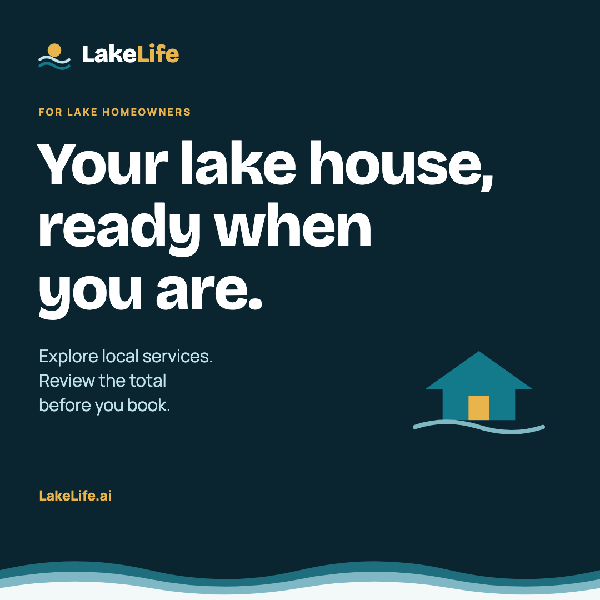
Earlier marketing material

📍**Big Long Lake** 

### Care for your lake home.

Seasonal home care

Review service

| Brand ingredient | Product translation |
| --- | --- |
| Logo | Use the same sun, waves and wordmark in the shared dark header. |
| Small drawings | Carry the service illustrations into discovery and relevant onboarding surfaces. |
| Emoji cues | Keep the established labels, camera/photo cue, location pin and restrained wave warmth. |
| Wave borders | Use the original layered wave at major hero/page boundaries. Use the thin repeating wave sparingly; leave dense money tables clear. |

Visual guidance only. Preserve current availability, prices, permissions and backend state rules.

Source anchors: Unchanged marketing example: brand-assets/marketing-examples/03-homeowner.png; original assets; ASSET-HANDOFF.md

## 14. Navigation: Put people in their own workspace.

Status: **CURRENT**. PDF page 15.

| Experience | Current entry | Navigation contract |
| --- | --- | --- |
| Park member | /portal → /park/today | Membership is checked before crew-invite conversion; show their park identity. |
| Resident with linked eligible stay | /portal → /parks/my | Include ended-stay money access where current code supports it. |
| Operations | /portal → /ops | Operational access is server-authorized. |
| Crew | /portal → /vendor | Today, Schedule, Open jobs, Availability, Rates, Crew, Earnings, Customers. |
| Homeowner | /portal → /book | Book services, My requests, Approvals, Messages, Billing, Property profile. |

### Park navigation stays grouped

**Today**  · **Renters**  · **Money**  · **On site**  · **Lots & rates**  · **Park setup** 

Use the existing second-row pills for grouped screens. Every page keeps its route and its title. “Load the roll” stays reachable after onboarding; the import tool is not only an empty-state action.

Current routing has moved the park landing to Today even though an older ParkNav comment still describes /park as the default. Executable routing wins for the current behavior. Keep selected navigation, URL and page heading aligned.

Source anchors: src/app/portal/page.tsx; src/components/OwnerNav.tsx; src/components/VendorNav.tsx; src/components/ParkNav.tsx

## 15. Buttons and actions: A verb, an object and a visible result.

Status: **REFERENCE**. PDF page 16.

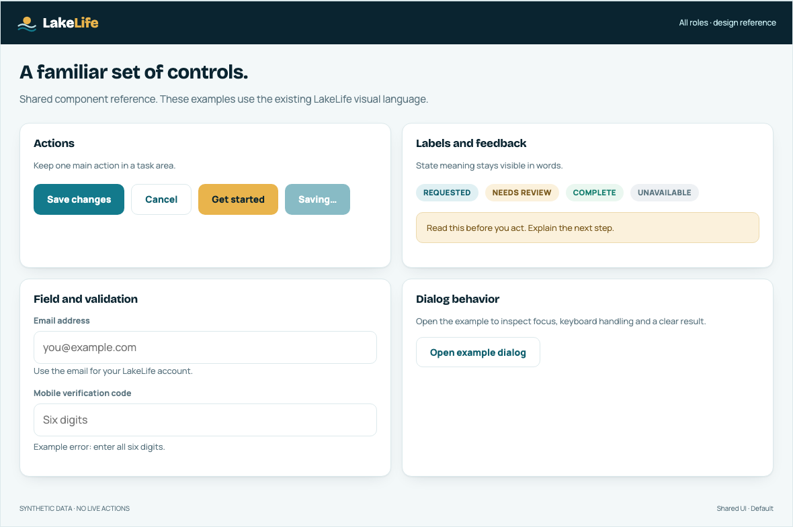
Reference component sheet using the existing palette, type and control shapes.

| State | Required behavior |
| --- | --- |
| Default / hover / focus | Use .ll-btn variants; preserve visible keyboard focus and a readable label. |
| Busy | Keep the action identifiable: “Saving changes…” or “Recording payment…”. Disable duplicate submission without hiding progress. |
| Blocked | Explain why next to the control. Do not leave a disabled action with no path forward. |
| Success | Show the saved result in the record. Toasts can confirm, but cannot be the only evidence of a money action. |
| Destructive | State what will change and what remains. Re-check authorization and current state on the server. |

Source anchors: src/app/globals.css; src/lib/design-system-holds.test.ts; reference/index.html#components

## 16. Forms and verification: Make each field feel answerable.

Status: **CURRENT + RECOMMENDATION**. PDF page 17.

**Labels** Keep a persistent label, optional helper and specific error. Placeholder text is an example, not the label. Use the existing .ll-field structure and styling.

**Input behavior** Use the appropriate input type, autocomplete and inputMode. Preserve user input when a server action fails. Show errors beside the field and focus the first invalid field after submit.

**Verification** Use the shared CodeBoxes component. It handles paste, backspace, autocomplete and the completed-code callback. Do not copy six independent inputs into a new form.

**Before first booking** A working email and SMS-verified mobile are required. Explain the remaining step; never infer verification from a field merely containing a value.

**Save behavior** One coherent form, one scoped save action. Show pending and saved states. If a second action has a separate consequence, label it as a separate task.

**Recommended error:**  “Enter a mobile number we can text.”
**Recommended recovery:**  “We couldn’t verify that code. Check the six digits or request a new code.”

Phone numbers may be stored in machine format but should display in the established readable format. Avoid technical provider errors in customer copy; keep diagnostic detail in authorized logs.

Source anchors: src/components/CodeBoxes.tsx; src/components/VerifyPanel.tsx; src/components/TextOptIn.tsx; src/app/api/verify/start/route.ts; src/app/api/verify/check/route.ts

## 17. Cards, tables and money: Keep the decision beside the record.

Status: **CURRENT + RECOMMENDATION**. PDF page 18.

| Pattern | Contract |
| --- | --- |
| Service card | Service name, relevant scope, one customer total or truthful quote state, and a booking action. Do not show a $0 fallback for unavailable pricing. |
| Task card | Who/what needs attention, why, consequence and the single next useful action. Order by actionable urgency. |
| Financial row | Amount, currency/context, time period, source/status and a clear action. Right-align comparable amounts; use tabular numerals. |
| Dense table | Stable headings, readable row boundaries and a real mobile strategy. Preserve the record identity when actions wrap. |
| Summary total | Compute from authoritative data and label the period. “Could not load” is different from “$0”. |
| Empty record | Say what is absent and how to create or request it. Use a separate error state when data could not be read. |

A resident-facing statement cannot include other households. The claim-slip print style must isolate the requested slip and exclude dashboard controls, other names, balances and unrelated records.

Recommended table handling on phones: switch key records to stacked cards, or give a genuine data table an explicitly labeled horizontal scroll region. Avoid shrinking text until the full desktop table fits.

Source anchors: src/components/BookingGrid.tsx; src/components/ClaimSlip.tsx; src/components/ParkStatements.tsx; src/lib/must-read.ts; src/app/globals.css

## 18. Dialogs and feedback: Never lose the task behind a message.

Status: **RECOMMENDATION**. PDF page 19.

| Moment | Interface contract |
| --- | --- |
| Dialog opens | Give it a name, move focus inside, keep focus within the modal and provide a visible close control. |
| Dialog closes | Restore focus to the trigger when appropriate. Escape and backdrop behavior must respect a write already in progress. |
| Waiting for a write | Prevent repeated submit; keep “Saving…” tied to that action. Do not navigate away before showing a durable result. |
| Read failure | Explain that the record could not be loaded and offer retry. Do not render fabricated empty rows or zero totals. |
| Write failure | Preserve input, explain whether anything changed and provide a safe retry or a reconciliation step. |
| Unknown money result | Tell the user the payment status needs checking. Avoid a blind retry that could create another charge. |

**Recommended read error:**  “We couldn’t load this record. Try again.”
**Recommended uncertain payment:**  “We’re checking this payment. Please don’t submit another payment yet.”

The reference dialog demonstrates keyboard containment and focus return. Audit real dialogs individually; the presence of role="dialog" alone does not prove accessible behavior.

Source anchors: src/components/TakePayment.tsx; src/components/AuthModal.tsx; src/components/BookingGrid.tsx; [W3C modal-dialog pattern](https://www.w3.org/WAI/ARIA/apg/patterns/dialog-modal/)

## 19. State vocabulary: Different objects need different status words.

Status: **REQUIRED**. PDF page 20.

| Object | Current / useful states | Do not collapse |
| --- | --- | --- |
| Job | requested, scheduled, in_progress, complete, paid, cancelled. Holds/no-show/stand-down also affect eligibility. | Requested ≠ scheduled. Complete ≠ financially settled in every related ledger. |
| Correction flag | pending, approved, declined. | A crew proposal is not a changed property profile. |
| Offline payment report | Reported, reviewed/confirmed, disputed as applicable to the current record. | A report is not money transferred through the app. |
| Online payment | Submitted / in flight, settled, failed or returned as supported by the payment record. | Submission ≠ settlement; a return can change the balance again. |
| Photo upload | Selected locally, uploading, stored, failed. | A local thumbnail is not an uploaded server record. |
| Message | Accepted/queued, delivered, failed/undelivered, held. | An API acceptance is not delivery. |
| Data loading | Loading, loaded empty, loaded data, failed, partial where explicitly supported. | A failed query is not empty success. |

These are display semantics across several objects, not a replacement database enum. Map each label to the actual source fields and use one authoritative transition path per object.

Source anchors: supabase/migrations/0001_schema.sql; 0019_delight_cancel_nickname_ics.sql; src/app/vendor/actions.ts; src/lib/sms-receipts.ts; src/app/parks/rent-capability.ts

## 20. Responsive behavior: Build for a thumb and a full desk.

Status: **CURRENT + RECOMMENDATION**. PDF page 21.

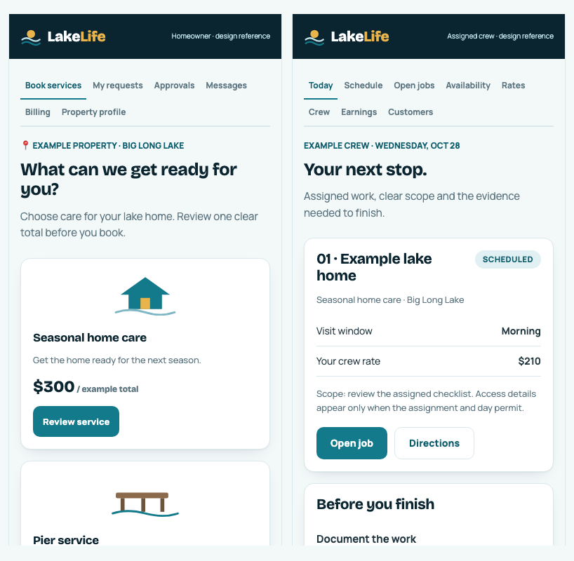
Initial phone viewports for a homeowner and crew member. Scrollable full-height references are included. All values are synthetic.

| Phone / field use | Desk / office use |
| --- | --- |
| Task and identity first; actions remain reachable without horizontal page scrolling. | Use a readable 1200 px maximum content width and stable alignment. |
| Inputs stay at 16 px; controls target at least 44 px height as a LakeLife usability goal. | Use density for comparison, not for hiding status or action consequences. |
| Stack card columns; allow navigation to wrap intentionally. | Keep related financial rows and the controlling action together. |
| Respect reduced motion and avoid decorative movement during work. | Support keyboard navigation, zoom, long labels and large amounts. |

Source anchors: src/app/globals.css; reference/index.html. Suggested review widths: 375, 390, 768, 1280 and 1440 px.

## 21. Accessibility: Readable. Reachable. Recoverable.

Status: **RECOMMENDATION**. PDF page 22.

| Review area | Acceptance target |
| --- | --- |
| Text contrast | At least 4.5:1 for normal text and 3:1 for large text. Measure actual rendered pairings. |
| Touch targets | LakeLife target: 44 px controls where practical. WCAG 2.2 AA target-size criterion uses 24 × 24 CSS px or permitted spacing/other exceptions. |
| Keyboard | Logical order, visible focus, semantic controls and complete modal handling. Never require pointer-only interaction. |
| Structure | One descriptive h1; meaningful headings; associated labels; status text in addition to color. |
| Validation | Specific errors with recovery. Announce changing results without forcing repeated screen-reader interruptions. |
| Motion and reflow | Respect prefers-reduced-motion; review zoom and narrow widths without losing actions or content. |
| Images | Describe meaningful job evidence; decorative logo/waves can be hidden from assistive technology when the adjacent name conveys identity. |

Treat WCAG 2.2 AA as the recommended review target. This guide does not certify the app. Record any existing mismatch and repair it with the smallest change that preserves the brand.

For long operations pages, include a practical way to reach the main content and ensure a task link visibly moves to the destination it opened.

Source anchors: [W3C contrast](https://www.w3.org/WAI/WCAG22/Understanding/contrast-minimum.html); [W3C target size](https://www.w3.org/WAI/WCAG22/Understanding/target-size-minimum.html); [W3C dialogs](https://www.w3.org/WAI/ARIA/apg/patterns/dialog-modal/). Reviewed 17 October 2026.

## 22. Visual baseline: The original cockpit still leads.

Status: **PROTOTYPE**. PDF page 23.

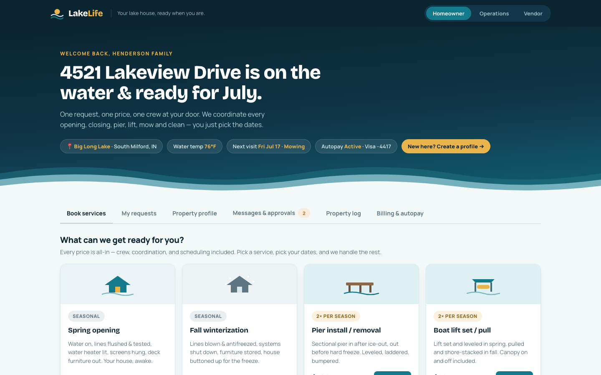
Original lakelife.html, captured locally. Names, amounts, dates and “Autopay Active” are prototype demonstration data.

**Preserve** Dark top bar, sun-and-wave identity, Bricolage display, Manrope body, mist page, white cards and teal actions.

**Translate carefully** Current routes, authorization, input sizing and backend-driven states replace prototype-only shortcuts. Do not copy fixed sample prices or the role switcher into production.

Use the screenshot as a visual baseline, not a current capability statement. The supplied reference screens are intentionally labeled and use synthetic fixtures.

Source anchors: lakelife.html; reference/screens/prototype-home.png

## 23. Homeowner / Book services: Start with the property. Offer relevant care.

Status: **REFERENCE**. PDF page 24.

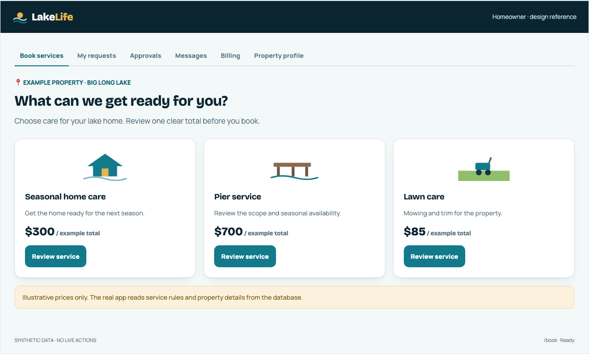
Reference composition for /book. Synthetic property and illustrative prices; no production data.

| Contract | Builder guidance |
| --- | --- |
| Entry / context | Require the correct signed-in owner and selected property. Show property identity before service selection. |
| Main action | Choose an applicable service. Keep one all-in total; derive it from current service data and the property profile. |
| States | Needs verification; needs property details; loading; no applicable service; unavailable quote; ready; read failure. |
| Recovery | Send the customer to the exact missing profile or verification step. Preserve the intended service where current navigation supports it. |

Source anchors: src/app/book/page.tsx; src/components/BookingGrid.tsx; src/components/PropertySwitcher.tsx; src/lib/pricing.ts

## 24. Homeowner / Booking: A request is the first committed step.

Status: **REFERENCE**. PDF page 25.

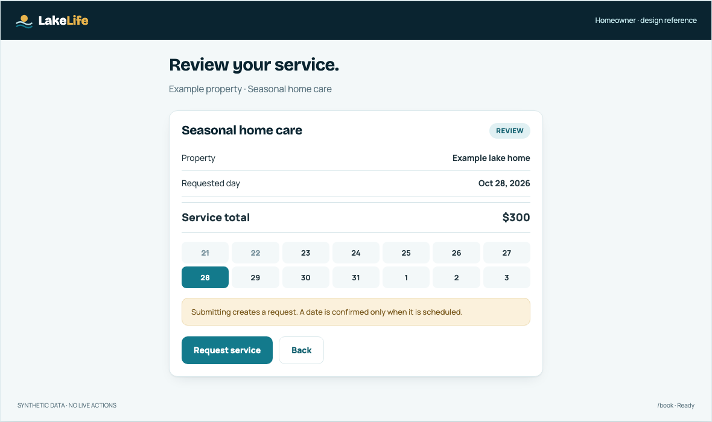
Reference booking panel, with illustrative $300 total and an explicitly unconfirmed date.

01 / **Review** Service, scope, property, total and the available date choices.

02 / **Validate** Account, property, service rules, season and capacity are checked by the server.

03 / **Request** Show the actual result. “Request received” until scheduling is confirmed.

Several selected days create separate requests in the current booking UI, not an undisclosed repeating schedule. Explain the count before submitting. A server rejection must preserve the selection and state what needs to change.

Source anchors: src/components/BookingGrid.tsx; src/app/book/actions.ts; src/lib/booking.ts; src/lib/lake-gate.ts

## 25. Homeowner / Request detail: Keep the promise and the evidence together.

Status: **CURRENT + RECOMMENDATION**. PDF page 26.

01 / **Requested** The request exists; a crew/date may still need confirmation.

02 / **Scheduled / in progress** Show the confirmed visit and current task status.

03 / **Complete** The server accepted completion with required evidence.

04 / **Payment record** Show the actual invoice/payment state separately.

| Display area | Required content |
| --- | --- |
| Identity | Service, property, request/visit identifier and relevant date. |
| Timeline | Readable status events with date/time context. Do not fabricate progress when a background process is delayed. |
| Work evidence | Authorized completion-photo gallery; useful shot labels where available. Distinguish missing evidence from a failed image load. |
| Exceptions | Pending correction, held work, cancellation or missing assignment remains visible with a next step. |
| Money | Customer total and their payment record; no crew cost or margin. |
| Actions | Only actions allowed in the current state, rechecked on the server. Explain cancellation/reschedule consequences before committing. |

Use date-only service dates without timezone drift. Use the Indiana lake-day helper for operational eligibility; the product owner’s desktop timezone must not determine a crew’s access day.

Source anchors: src/app/requests/[id]/page.tsx; src/lib/photos.ts; src/lib/booking.ts; src/app/vendor/actions.ts

## 26. Homeowner / Approvals: Show the change before asking for approval.

Status: **REFERENCE**. PDF page 27.

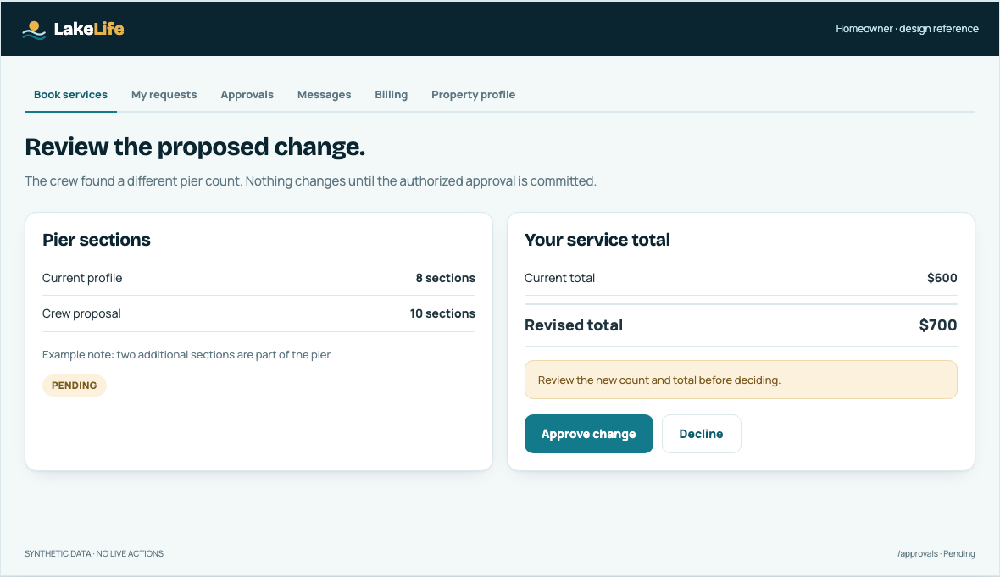
Reference correction review. Example section counts and totals are synthetic.

| Show together | Enforce together |
| --- | --- |
| Current value → proposed value, crew explanation and relevant evidence. | Authenticate owner access to this flag and property. |
| Current total → revised total, using customer-facing prices only. | Re-read pending status and calculate from authoritative service rules. |
| Approve and decline actions with clear consequences. | Required: profile change and repricing are atomic. Current code separates them; see the implementation-gap register. |
| Decision result and updated record. | Handle already-decided and concurrent submissions without applying another change. |

Source anchors: src/app/approvals/actions.ts; supabase/migrations/0011_lock_flag_photo_writes.sql and later amendments; AGENTS.md rule 6

## 27. Homeowner / Profile and billing: Collect what the service actually needs.

Status: **CURRENT**. PDF page 28.

**Property profile** Group address/lake, home details, pier/lift equipment, boats/toys, lawn and access. Preserve existing wizard components and applicability rules; do not ask for every possible service field at once.

**Price-changing details** Explain which counts affect the quote. Save the profile through its authorized action. A crew flag cannot silently bypass the homeowner approval flow.

**Access information** Keep gate and door information out of list previews, analytics, logs and public messages. Server rules decide when an assigned vendor can receive it.

**Payment method** Use hosted tokenization. Display a safe description such as brand and last four digits, not sensitive account data. A saved token does not prove live charging is enabled.

**Invoices and receipts** Label due, paid, failed, refunded or processing according to the actual financial record. Keep always-on email receipt behavior distinct from optional reminders.

Current code includes more services and pricing cases than the original five-model description. Reuse the service applicability and pricing engine; do not invent a second calculator in the interface.

Source anchors: src/app/profile/page.tsx; src/components/ProfileWizard.tsx; src/components/PaymentMethods.tsx; src/app/billing/page.tsx; src/lib/pricing.ts; src/lib/notifications.ts

## 28. Crew / Today: The next stop should be obvious.

Status: **REFERENCE**. PDF page 29.

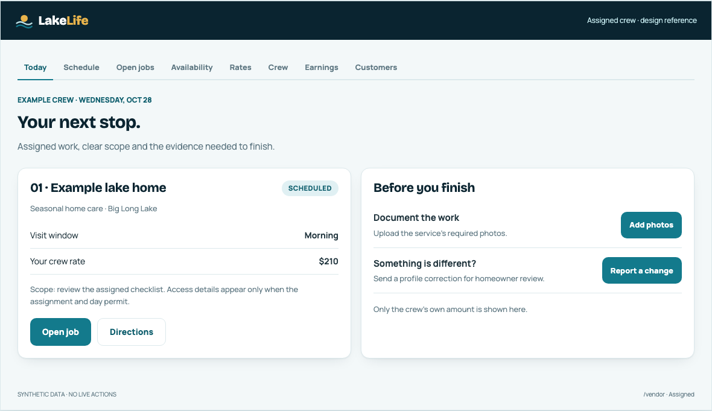
Reference /vendor task view. The displayed crew amount is synthetic and is not a customer price.

| Priority | Contract |
| --- | --- |
| Orient | Crew identity, work date and assigned stops. Keep the stop number, address and scope together. |
| Act | Directions, job details, photo capture and completion actions use readable labels and touch-friendly controls. |
| Know the boundary | Show the crew’s own rate/payout only. Omit customer_price and margin from payloads, exports, HTML and client state. |
| Handle trouble | Explain blocked access, held work, missing evidence and unavailable data. Keep safe recovery visible. |

Source anchors: src/app/vendor/page.tsx; src/app/vendor/data.ts; src/components/VendorNav.tsx; AGENTS.md rules 1–3

## 29. Crew / Completion evidence: Photos are part of completing the job.

Status: **REFERENCE**. PDF page 30.

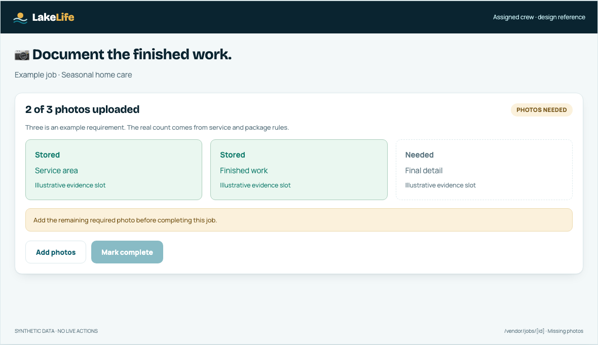
Reference photo gate. “2 of 3 uploaded” is illustrative; actual requirements come from service data.

| UI behavior | Backend meaning |
| --- | --- |
| Show stored count and required count. | Read authoritative job_photos and service requirements; include package-leg requirements. |
| Keep uploading / failed separate from stored. | A selected local file does not count toward completion. |
| Explain why completion is unavailable. | The server and database enforce photo and held-work gates even if a client bypasses a disabled button. |
| Show a durable completed result. | Completion may initiate later work; it is not proof that a payment or payout has settled. |

Source anchors: src/app/vendor/actions.ts completeJob / uploadJobPhoto; src/app/vendor/photo-evidence.test.ts; supabase/migrations/0050_enforce_rules_in_db.sql; 0084; 0146

## 30. Crew / Schedule and earnings: Separate capacity, work and money.

Status: **CURRENT + RECOMMENDATION**. PDF page 31.

**Schedule** Use the existing calendar and dated job detail. A future job cannot be completed early. Show holds and unavailable periods without implying the crew has accepted new work.

**Availability** Open, blocked and booked have different meaning. Saving a block needs a visible result; a failed save cannot leave a permanently successful-looking cell.

**Open jobs** Describe the real action: claim, accept, propose or decline as the implementation allows. Revalidate capacity, coverage and insurance when a job is taken.

**Rates** The crew edits its own rates through the existing controlled flow. Never show platform margin, customer price or a suggested rate reverse-engineered from the customer total.

**Earnings** Show earned, held, approved, sent or settled according to actual payout records. A downloadable batch or a completed job does not automatically mean funds arrived.

**Crew and customers** Preserve existing onboarding/import workflows. A crew invitation must not accidentally overwrite a park member’s identity or grant access to unrelated properties.

Source anchors: src/app/vendor/schedule/page.tsx; availability/actions.ts; rates-actions.ts; earnings-data.ts; src/app/portal/page.tsx

## 31. Park office / Today: Lead with what needs the office.

Status: **REFERENCE**. PDF page 32.

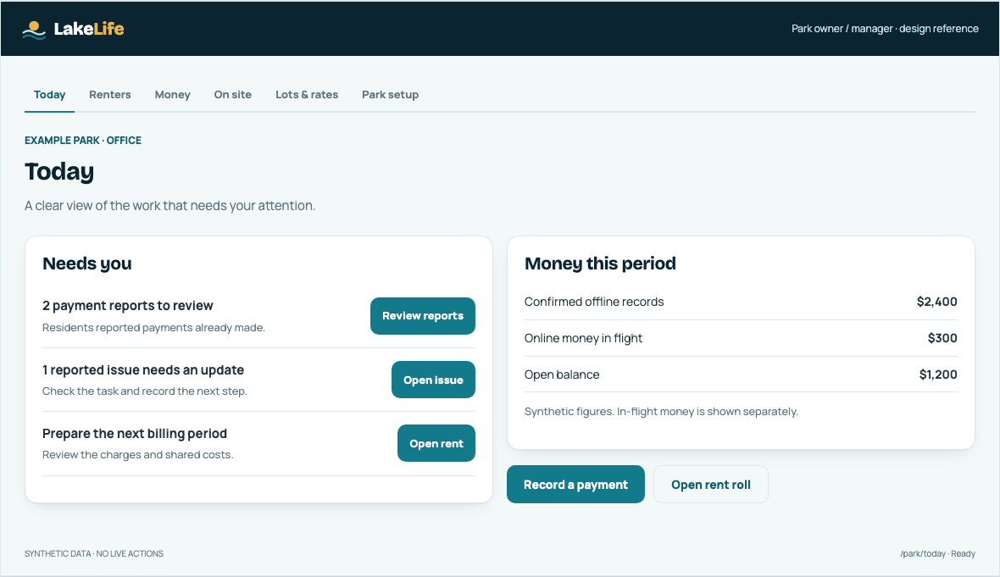
Reference /park/today layout. Synthetic task counts and money summary.

| Area | Contract |
| --- | --- |
| Park identity | Show the current park and live/not-published state. Keep a notices-held banner visible across the park area when applicable. |
| Needs you | Actionable tasks before money on the phone. Each action should take the user to the actual relevant record. |
| Money context | Use the correct period and distinguish collected money from in-flight payments. |
| Shared action | Preserve the existing TakePayment doorway across park navigation; recording offline payment is a distinct action from online collection. |

Source anchors: src/components/ParkToday.tsx; src/components/ParkNav.tsx; src/app/park/today/page.tsx; src/components/TakePayment.tsx

## 32. Park office / Rent roll: A row is a household and a record.

Status: **REFERENCE**. PDF page 33.

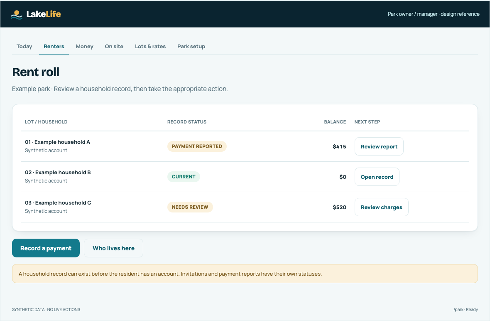
Reference rent roll with synthetic households, balances and record states.

| Show | Protect |
| --- | --- |
| Lot, resident, tenancy context, balance and record confidence. | Scope every read to the authorized park; do not expose neighboring parks. |
| A clear path to the household’s charges, payments and account invitation. | A resident need not have logged in for the office to administer the existing record. |
| Useful status and date context beside an amount. | Keep reported payments separate from confirmed payments and settlement. |
| A focused slip/statement print action. | Print only the intended household artifact; never the entire rent roll. |

Source anchors: src/components/ParkRentRoll.tsx; src/app/park/data.ts; src/components/ClaimSlip.tsx; src/app/globals.css print rules

## 33. Park office / Offline payment: Record what happened. Confirm the right amount.

Status: **CURRENT + RECOMMENDATION**. PDF page 34.

01 / **Identify** Select the correct household and lot; show current account context.

02 / **Record** Enter amount, method, date and relevant reference through the existing form.

03 / **Review** Confirm the scope and consequences before the record is committed.

04 / **Receipt** Show the durable result and offer the authorized receipt/print route.

| Failure case | Required behavior |
| --- | --- |
| Resident says “I already paid” | Treat it as a report for office review. Do not imply the app transferred money. |
| Double click or retry | Use existing idempotency/uniqueness controls; avoid adding a second financial record. |
| Submission uncertain | Keep context, show a reconciliation route and do not instruct a blind repeat. |
| Wrong household | Require correction through the actual money-action path; no ad hoc client-side ledger edits. |
| Dialog closes during write | Preserve the in-flight result path. Current TakePayment blocks inappropriate close behavior while busy. |

Keep commercial policy and accounting behavior in the established server functions. The UI is a clear view and controlled entry point into those rules, not a separate ledger.

Source anchors: src/components/TakePayment.tsx; src/components/IPaidForm.tsx; src/app/park/money-actions.ts; src/app/park/ledger-actions.ts

## 34. Park office / Shared costs: Make the allocation explainable.

Status: **CURRENT + RECOMMENDATION**. PDF page 35.

01 / **Source cost** Amount, category, period and the existing source-note fields.

02 / **Allocation** Eligible lots and the configured allocation rule.

03 / **Charges** Review each resulting lot amount before the allowed commit.

04 / **Statement** Show each resident their own charge and explanation.

| Design rule | Implementation consequence |
| --- | --- |
| Explain the basis | Show the source amount and allocation method where the office reviews it. Do not invent invoice attachments if the workflow only stores a source note. |
| Use the correct population | Shared-cost allocation and LakeLife software-fee eligibility answer different questions; do not reuse one lot-count helper for both. |
| Reconcile cents | The sum of allocated charges must match the intended amount under the existing rounding policy. |
| Keep fee streams separate | LakeLife’s park-platform invoice is a park-owner obligation, not an automatically added resident charge. |
| Expose partial failure | A failed allocation/read must not look like a valid zero-cost result. Preserve a safe review/retry path. |

Illustrative arithmetic: a $300 shared cost split equally across 20 eligible lots is $15 per lot. This example does not define the park’s real allocation rule.

Source anchors: src/components/ParkCosts.tsx; src/app/park/cost-actions.ts; src/lib/park-platform-fee.ts

## 35. Park office / Setup and import: A clear start without hidden sends.

Status: **CURRENT + RECOMMENDATION**. PDF page 36.

| Step | UI and state contract |
| --- | --- |
| Park setup | Show identity, configuration and notice-hold state. Separate “not published” from an error. |
| Lots and rates | Support the existing bulk setup workflow. Keep lot lifecycle, service status and rate changes visible. |
| Load the roll | Show source data, proposed matches, conflicts and corrections before committing the import. Keep the tool reachable after initial setup. |
| Who lives here | Administer known residents even when they have no app account. Do not invent an account to represent a tenancy. |
| Who can open this park | Use the existing owner/manager invitation and membership controls. Show pending, accepted and failed states truthfully. |
| Resident invitations | Use the correct household link and actual delivery status. A successful click is not proof that an email or text arrived. |
| Readiness | Show actionable blockers and name the next required task. Lift notice holds only through the established authorized action. |

**Recommended principle:**  setup should still be useful if a resident never opens the app. Office records and account access are related but separate.

The older park blueprint contains proposed phases and competitor claims. Use current code for shipped behavior; do not implement every historical idea as part of this design handoff.

Source anchors: src/components/ParkNav.tsx; ParkImportRead.tsx; ParkReadiness.tsx; src/app/park/import; src/app/park/people/page.tsx; docs/park-experience-blueprint.md

## 36. Resident / My lot: Their bill. Their updates. Their choices.

Status: **REFERENCE**. PDF page 37.

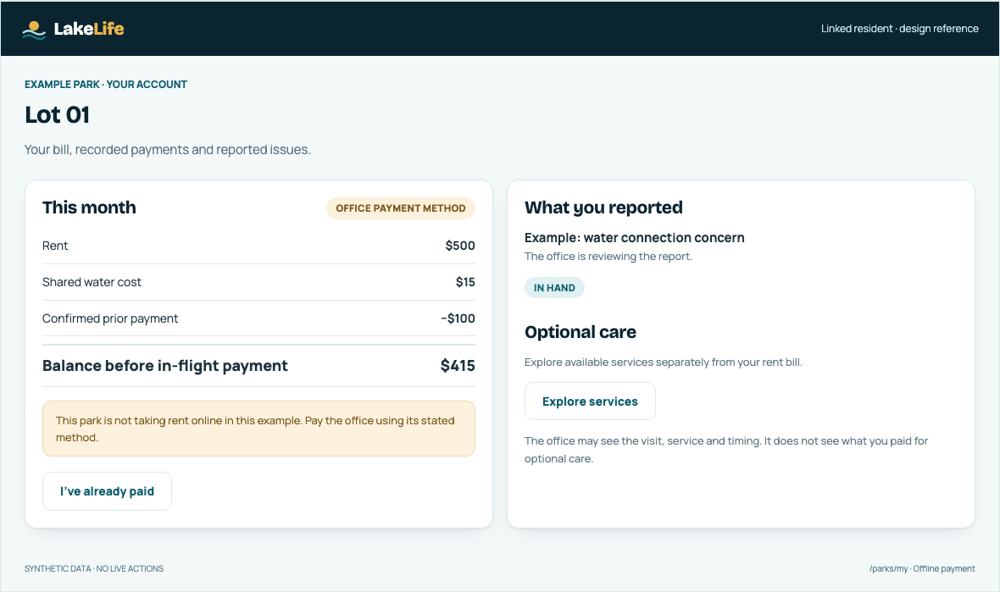
Reference /parks/my account. Synthetic lot, bill and reported issue.

| Priority | Contract |
| --- | --- |
| Own account | Verify the linked resident/tenancy and show the correct lot. Keep ended-stay financial access where current code supports it. |
| Payment clarity | Show bill breakdown and available methods. Separate report, in-flight payment and settlement. |
| Issue clarity | Show the status and recorded resolution. A QR reporting route exists only after the park installs its actual sticker. |
| Optional services | Keep separate from rent. Office may see visit, service and timing; it does not see what the resident paid for optional care. |

Source anchors: src/components/RenterHome.tsx; src/app/parks/my-data.ts; src/app/parks/claim/page.tsx; src/app/portal/page.tsx

## 37. Operations / Home: Make the exception impossible to miss.

Status: **REFERENCE**. PDF page 38.

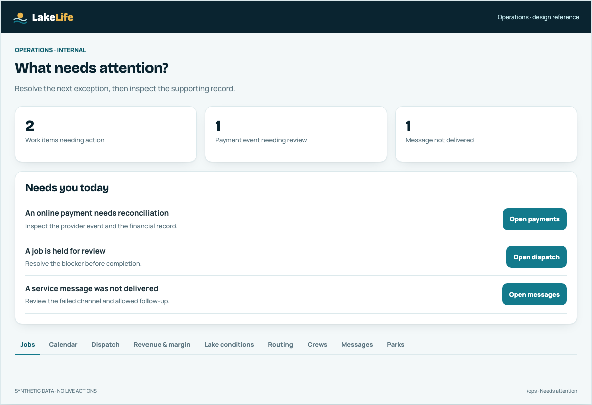
Reference operations console. All counts and alerts are synthetic.

| Priority | Contract |
| --- | --- |
| Needs you today | Present the actionable task before long lower-page panels; a button should visibly open and move to its destination. |
| Health | Show payment, communication and data-read problems as distinct states. Never replace a failed read with a reassuring zero. |
| Work areas | Preserve Jobs, Calendar, Dispatch, Revenue & margin, Lake conditions, Routing, Crews, Messages and Parks. |
| Financial detail | Internal totals and margin are operations-only. Redact them from every lower-permission response and export. |

Source anchors: src/app/ops/page.tsx; src/components/ops/OpsToday.tsx; OpsTabs.tsx; OpsShell.tsx; src/app/ops/money-rail-data.ts

## 38. Operations / Dispatch and jobs: The action should explain what it will change.

Status: **CURRENT + RECOMMENDATION**. PDF page 39.

**Job board** Filter without losing record identity. Show request/schedule state, assigned crew, property, date and active blockers. Open the same canonical job detail for follow-up.

**Assignment** Explain coverage, availability, capacity, valid insurance and season constraints. The server revalidates all relevant rules when the assignment is committed.

**Held work** Show the reason and the person/action needed to resolve it. A margin issue is internal; the crew and customer receive only the explanation appropriate to their task.

**Routing** Keep stop order and the list usable when the map fails. Do not equate a generated route with a message delivered to a crew. Preserve per-lake and seasonal constraints.

**Job file** Place scope, status, evidence, corrections and financial records in a traceable order. Keep the distinction between work completion, customer charge and crew payout.

The original prototype uses Leaflet as a demonstration layer. The approved stack specifies Google Maps JS SDK and Directions API. Do not substitute a new mapping stack to match the demo implementation.

Source anchors: src/components/ops/JobBoard.tsx; JobFile.tsx; NeedsAttention.tsx; RouteBuilder.tsx; src/lib/router.ts; AGENTS.md

## 39. Operations / Money and delivery: Unknown is a real state.

Status: **CURRENT + RECOMMENDATION**. PDF page 40.

| Signal | What the operator needs |
| --- | --- |
| Processor unavailable | A clear platform-level reason and the next setup/check step; do not blame a resident’s bank or card. |
| Park merchant not ready | Show the owner’s setup requirement in the authorized office/ops context; residents receive a simpler payment-method message. |
| Payment in flight too long | Amount/age/context and a safe investigation link. Do not count it as settled money. |
| Unread processor event | An actionable exception with event identity and processing state; no duplicated financial side effects on replay. |
| Message delivery failure | Channel, useful failure reason and allowed recovery. “Accepted” does not mean “delivered”. |
| Notice hold | Make the hold visible across relevant screens. Do not silently send around it. |
| Read failure | Explicit unavailable/partial state. Never present failed money reads as zero owed, zero risk or zero outstanding work. |

**Backend visual rule:**  every alarm has a reason, scope and next action. Every summary links to its underlying records. A dashboard should help someone finish a task, not merely display colored totals.

Source anchors: src/app/ops/money-rail-data.ts; src/app/parks/rent-capability.ts; src/lib/must-read.ts; src/lib/sms-receipts.ts; src/components/ops/OpsPaymentSetup.tsx

## 40. System architecture: The interface asks. The server decides.

Status: **REQUIRED**. PDF page 41.

**Role-specific Next.js UI** Homeowner · Crew · Park office · Resident · Operations

**Authorized server actions and route handlers** Session → ownership/membership → input → current state → business rule

**Supabase** Postgres rules + transactions
Auth + scoped access
Private Storage + signed URLs

**External services** Hosted payment processor
Twilio Verify / Messaging
Resend · Google Maps

**Durable record and observed outcome** Persisted state → authorized view → customer confirmation / operational follow-up

| Boundary | Contract |
| --- | --- |
| Browser | No service-role credentials, payment secrets, raw card data or forbidden role fields. |
| Server | Authorize before privileged reads/writes and photo signing. Validate state again at commit time. |
| Database | Enforce key invariants even if a client bypasses UI checks; preserve migration-owned constraints. |
| Providers | Treat webhooks, delivery receipts and settlement events as evidence; authenticate and deduplicate them. |

Source anchors: Approved stack: AGENTS.md. Current boundaries: src/lib/supabase/server.ts; src/lib/payments-server.ts; src/app/api; supabase/migrations.

## 41. Data relationships: One record can power several safe views.

Status: **CURRENT + REQUIRED**. PDF page 42.

| Domain | Relationship / view boundary |
| --- | --- |
| Identity | users account role; park_members authorizes the park office; linked park renter/stay records identify resident access. |
| Property care | properties → property_profile, boats/toys → jobs → job_photos and flags. Scope through ownership or assignment. |
| Service rules | services drives pricing, required photos and service behavior. The UI must not own a separate rate list. |
| Crew work | vendors + availability → assignments/routes → job evidence and allowed completion. |
| Park records | parks → lots, resident records and reservations → charges, payment records and statements. Scope by park and household. |
| Financial records | Charges, invoices, payments, refunds and payouts have separate lifecycles. Never infer one state solely from another. |
| Communications | Notification preferences/holds govern sending; provider events describe the observed delivery outcome. |

This is a conceptual map, not a migration proposal. Use the current schema and migrations for exact table names, constraints and relationships. Do not recreate the July schema from scratch.

With a Supabase service-role client, RLS is bypassed. The existing park loader therefore checks the session/membership and explicitly scopes each query. A UI filter is not a replacement for that boundary.

Source anchors: src/app/park/data.ts; src/app/parks/my-data.ts; src/app/vendor/data.ts; supabase/migrations; src/lib/photos.ts

## 42. Action contract: Every mutation needs a clear answer.

Status: **REQUIRED**. PDF page 43.

01 / **Prove** Authenticate the session and authorization for the specific record.

02 / **Check** Validate input, capability, current state and business constraints.

03 / **Commit** Use the required transaction and replay/duplicate protection.

04 / **Return** Provide a truthful result that the UI can display and reconcile.

| Outcome | UI response |
| --- | --- |
| Committed | Refresh the authoritative record and show a persistent success state. |
| Rejected before change | Explain the precise corrective action; keep the user’s input. |
| Read failed | Do not guess eligibility, money or identity from missing data. Offer retry without a misleading zero. |
| Already applied | Return or recover the existing outcome; do not duplicate side effects. |
| Outcome uncertain | Keep the action in a checking/reconciliation state; do not claim success or invite a blind retry. |

Adapt the existing server-action result types. Keep authorization, commit/replay handling and role-safe responses in their current shared boundaries; do not add a parallel mutation layer.

Notifications are a separate observed outcome. A saved record can coexist with a failed notification; show that distinction to the person who can act on it.

Source anchors: src/lib/must-read.ts; src/app/book/actions.ts; src/app/vendor/actions.ts; src/app/park/money-actions.ts; src/lib/charge-gate.ts

## 43. Evidence and access: Make privacy and proof survive a direct request.

Status: **REQUIRED**. PDF page 44.

| Invariant | Enforcement / interface consequence |
| --- | --- |
| Photo gate | Completion and payout eligibility depend on server-counted evidence and current service/package requirements. Database triggers remain the final guard. |
| Held work | A held, no-show or stood-down job cannot be completed merely because photos exist. Explain the blocking condition. |
| Private images | Authorize before minting a signed URL. Current shared photo URL TTL is 3600 seconds; do not place bearer URLs into public messages or cached pages. |
| Day-of-job codes | Only the assigned vendor, for the valid scheduled day and live assignment, can receive the decrypted access information. Use the Indiana operational date. |
| Encrypted at rest | Current gate encryption is server-side AES-256-GCM. Door-code and bank-secret keys are separate. Never ship encrypted blobs or keys as UI props. |
| Evidence integrity | Keep stable photo IDs and distinguish device file time from verified capture claims. An upload-row count does not itself prove every image can currently be displayed. |

Verify direct server and database paths, not only button states. Include denied-role, wrong-record, future-day, missing-photo, held-job and storage-read-failure cases in tests.

Source anchors: src/lib/gate.ts; src/lib/photos.ts; src/app/vendor/data.ts; src/app/vendor/actions.ts; supabase/migrations/0050_enforce_rules_in_db.sql; 0084; 0146

## 44. Pricing and seasons: One calculator. One operational calendar.

Status: **REQUIRED**. PDF page 45.

| Rule | Build contract |
| --- | --- |
| Service pricing | Use src/lib/pricing.ts with service rows and the complete profile. Preserve current flat, counted, per-foot, band, per_sqft_band and seasonal_plus_perdiem cases. |
| Model naming | The project brief uses sqft_band shorthand; the current code enum is per_sqft_band. Do not rename stored values from a prose label. |
| Price visibility | Customer sees one total; crew sees its own rate/payout; cost and margin stay in ops. Masking after serialization is insufficient. |
| Corrections | The required approval outcome is atomic profile change + repricing. Current implementation gap is documented for repair. |
| Season window | Respect actual per-lake ice-out and pull deadline; pull deadline is estimated hard freeze minus eight days. |
| Dates | Use YYYY-MM-DD date semantics and todayLakeDate() for Indiana operations. Avoid browser/UTC slicing that shifts eligibility. |
| Scheduled processing | Verify the deployment schedule against the intended local-time behavior, including daylight-saving changes. A cron string alone is not proof of an 8 pm local run. |

Do not use reference-screen dollar values as defaults or seeds. No amount in the visual fixture is an approved service price.

Source anchors: src/lib/pricing.ts; src/lib/booking.ts; src/lib/lake-gate.ts; src/lib/router.ts; src/app/approvals/actions.ts; vercel.json; AGENTS.md

## 45. Payments: Capability first. Settlement later.

Status: **CURRENT + REQUIRED**. PDF page 46.

01 / **Capability** Platform processor readiness + park switch + approved receiving account + allowed method.

02 / **Submit** Hosted token/authorized method and a stable operation key; show in-flight state.

03 / **Observe** Verify and deduplicate provider events; reconcile the actual outcome.

04 / **Reflect** Update the right ledger/view and show settled, returned, failed or still checking.

| Audience | Appropriate explanation |
| --- | --- |
| Resident | “This park isn’t taking online rent yet. Use the payment method your office gives you.” |
| Park owner | Show the actual missing setup/capability and next action. Do not expose unnecessary platform secrets. |
| Operations | Show platform readiness, merchant capability, unread events and payments that require reconciliation. |
| Crew | Show its own payout status; do not reveal the customer charge or platform economics. |

Current service-card server code is a mock adapter. ACH/card capability logic exists, but source code is not evidence that any deployment or park is live. Verify the actual processor, merchant, webhook and settlement path before promising online collection.

Source anchors: src/lib/payments.ts; src/lib/payments-server.ts; src/lib/charge-gate.ts; src/app/parks/rent-capability.ts; src/app/api/processor/webhook/route.ts; migration 0191

## 46. Notifications: Saved, sent and delivered are three different facts.

Status: **CURRENT**. PDF page 47.

01 / **Event** Booking, service reminder, completion, approval, receipt or seasonal event.

02 / **Eligibility** Account destination, channel preference, consent and park notice hold.

03 / **Attempt** Provider accepts or rejects; preserve a useful attempt record.

04 / **Receipt** Verified callback updates delivered/failed/waiting; operator can follow up.

| Design rule | Consequence |
| --- | --- |
| Receipts | Email receipts stay always-on under the project rules; do not accidentally place them behind an optional reminder toggle. |
| Customer copy | Say “sent” only for the corresponding actual send state, and “delivered” only with delivery evidence. |
| Failure visibility | A core action can succeed while its notification fails. Tell the authorized operator what needs follow-up. |
| Photo links | Link to an authorized portal route, not a long-lived public evidence URL. |
| Retry | Respect existing hold/consent logic and avoid duplicate reminders from event replay. |

Current NOTIF_DEFS includes text + email for booking, day-of-service reminders, completion and approvals, with email for receipts and seasonal reminders. Use the current definitions rather than the older prototype channel wording.

Source anchors: src/lib/notifications.ts; src/lib/notif-gate.ts; src/lib/recipient-gate.ts; src/lib/sms-receipts.ts; src/app/api/twilio/status/route.ts; src/app/api/resend/webhook/route.ts

## 47. Cross-role journey: Follow one job across the whole system.

Status: **REQUIRED**. PDF page 48.

| Step | Customer | Crew | Operations / system |
| --- | --- | --- | --- |
| 1 / Request | Review scope and total; submit the requested date. | No implied confirmed assignment. | Authorize; validate profile, season, price and availability; create request. |
| 2 / Schedule | See confirmed scheduling when it exists. | Receive assigned job and own scope/rate. | Validate crew eligibility and capacity; persist assignment. |
| 3 / At property | Respond if a correction needs approval. | Access only permitted day-of-job details; report a discrepancy. | Hold affected work where required; preserve the approval boundary. |
| 4 / Evidence | See authorized work photos after they exist. | Upload required evidence and request completion. | Count server records; enforce photo/hold/date rules. |
| 5 / Money | See actual customer charge/payment state. | See actual own payout state. | Reconcile financial events; completion does not fabricate settlement. |
| 6 / Follow-up | Review result or report a problem. | Respond through the supported cure/dispute path. | Keep evidence and the financial record traceable. |

The companion Mermaid flow separates work state from financial state and shows where the server rechecks each decision. It is a conceptual flow, not a replacement for current state-machine code.

Source anchors: diagrams/service-journey.mmd; src/app/book/actions.ts; src/app/vendor/actions.ts; src/app/approvals/actions.ts; src/lib/charge-gate.ts

## 48. Cross-role journey: Follow a park bill to a trustworthy record.

Status: **REQUIRED**. PDF page 49.

| Step | Office | Resident | System contract |
| --- | --- | --- | --- |
| 1 / Prepare | Reconcile lots, households, starting balances and rules. | May not yet have an account. | Office records exist independently of login. |
| 2 / Bill | Review scheduled charges and shared-cost allocation. | View own breakdown when connected. | Use the correct park/household scope and charge rules. |
| 3 / Pay or report | Record/confirm offline payment, or support enabled online methods. | Pay through an enabled method or report a payment already made. | Report ≠ transfer; in-flight ≠ settled. |
| 4 / Reconcile | Review mismatches, returns and outstanding items. | See actual record changes and receipts. | Provider events and authorized office actions determine state. |
| 5 / Support | Correct through the existing action path. | Ask the office about a specific charge or report. | Keep an auditable record; no ad hoc client ledger edits. |
| 6 / Move out | Complete the supported closeout process. | Retain access to relevant final money records. | Do not redirect ended stays away from their financial record. |

A LakeLife platform fee belongs to the park-owner relationship. A resident’s optional service purchase belongs to that household. Keep both separate from shared park expense allocation.

Source anchors: diagrams/park-money-journey.mmd; src/app/park/data.ts; money-actions.ts; ledger-actions.ts; src/app/parks/my-data.ts; src/app/portal/page.tsx

## 49. Acceptance checks: Test the boundary, then review the screen.

Status: **HANDOFF**. PDF page 50.

| Area | Meaningful acceptance check |
| --- | --- |
| UI-02 / Responsive | No clipped actions or horizontal page overflow; intended data-table scrolling is labeled. |
| UI-03 / Keyboard | Visible focus, logical order, focus containment/return and operable controls. |
| UI-04 / Data state | Explicit error, never a fabricated zero or empty success. |
| AUTH-01 / Role access | Server denies access and returns no forbidden fields. |
| AUTH-02 / Data projection | No customer price or margin in any crew-visible payload. |
| JOB-01 / Photo gate | Server/database reject; no payout eligibility release. |
| PRICE-01 / Pricing | Current service data drives math; no hardcoded rate fallback. |
| PRICE-02 / Approval atomicity | Required target: no partial profile/price commit; mark existing gap until fixed. |
| MONEY-02 / Replay | At most one intended financial side effect. |
| PRINT-01 / Privacy | Only intended slip content prints; no other household data. |

The companion acceptance-checklist.csv includes all 18 scenarios, starting conditions and expected results, with blank result/evidence fields for Claude Code to fill during implementation.

This documentation task does not claim the application passed these scenarios. After implementation, run relevant existing tests and record the actual outcomes. Avoid tests that merely mirror new markup.

Source anchors: Relevant existing suites: src/lib/pricing.test.ts; booking.test.ts; gate.test.ts; charge-gate.test.ts; must-read.test.ts; design-system-holds.test.ts; src/app/vendor/photo-evidence.test.ts; src/app/api/processor/webhook/route.test.ts

## 50. Implementation order: Work in small, reviewable phases.

Status: **HANDOFF**. PDF page 51.

| Phase | Scope | Done when |
| --- | --- | --- |
| 1 / Establish baseline | Read project instructions and this handoff; inspect current screens and routes; map gaps. | Screenshots and a short source-backed gap list exist; no accidental product expansion. |
| 2 / Shared visual corrections | Use existing tokens/components; fix proven spacing, contrast, focus and responsive defects. | Changes are consistent across affected roles and pass relevant tests. |
| 3 / Role flows | Improve the selected high-value task with all loading, empty, busy, blocked and failure states. | The owner can complete the task and understand its result on phone and desktop. |
| 4 / Backend integrity | Address approval atomicity and other verified behavior gaps using existing architecture. | Direct-path tests prove the invariant, including failure and concurrent attempts. |
| 5 / End-to-end review | Walk a homeowner job and a park bill through all relevant roles. | State, money, evidence, access and notification behavior match the source of truth. |
| 6 / Handoff | Summarize change, browser review steps, test results and remaining limitations; commit milestone. | The product owner has a concrete reviewable result and no unsupported “done” claims. |

Do not deploy, publish, switch live payments on or send resident notices merely because this guide describes them. Implement within the actual work authorization and environment controls.

Source anchors: AGENTS.md / CLAUDE.md ways of working; current package.json test/build scripts

## 51. Implementation-gap register: Resolve differences without losing the brand.

Status: **CURRENT OBSERVATIONS**. PDF page 52.

| Priority / evidence | Current observation | Builder response |
| --- | --- | --- |
| P1 / approval atomicity | approveFlag calls apply_flag_change, then reprices jobs in application code. A retry path acknowledges partial progress. | Required rule 6 is broader than the current transaction. Design/test an atomic outcome before reporting full success. |
| Review / active navigation | Prototype main tabs use a gold underline; current owner/park navigation uses teal. | Preserve current consistent navigation while documenting the deliberate difference; do not restyle opportunistically. |
| Review / public headline | Prototype tagline differs from the current public page/metadata headline. | Keep approved copy in context. Ask the owner before a global message replacement. |
| Review / modal and focus | Some dialogs declare semantics; this does not establish complete focus handling. | Audit each real modal and correct verified issues using shared behavior. |
| Review / contrast | Some existing gold/warning pairings fail normal-text contrast on white. | Use tested existing darker pairings or propose a minimal semantic-token correction. |
| Verify / nightly schedule | The launch plan says 8 pm; vercel.json contains 0 0 * * * for nightly. | Verify provider timezone and daylight-saving behavior against intended Indiana operations. |
| Verify / live capability | Mock payment code and capability checks coexist. | Validate the real deployment and merchant setup; do not infer readiness from a button. |

This is a targeted source review for a design handoff, not a complete security, accessibility or production-readiness audit. Findings are not fixes.

Source anchors: src/app/approvals/actions.ts:112 onward; migration 0159 apply_flag_change; lakelife.html; globals.css; layout.tsx; vercel.json; payments-server.ts

## 52. Final handoff: Give Claude Code the whole package.

Status: **HANDOFF**. PDF page 53.

### Start with these files

- START-HERE.md for the implementation prompt and reading order.
- LakeLife-Product-Design-Handbook.md for searchable rules and source pointers.
- reference/index.html for interactive role layouts and state examples.
- design-tokens.json, route-inventory.csv and screen-contracts.json for structured references.
- acceptance-checklist.csv and diagrams/*.mmd for verification and flow details.

### Use the repository as the authority

Keep AGENTS.md, CLAUDE.md, lakelife.html, the beta plan, current components and migrations available to the builder. The package supplements those files; it does not replace them or approve every historical proposal.

### Ask for a concrete milestone

“Start by comparing the current screens with this handoff. Show the highest-impact gaps, then implement a small first phase using the existing brand and stack. Include loading and failure states, relevant tests, phone/desktop screenshots and plain-English review steps.”

All role-screen compositions in the reference are synthetic design examples. Only the explicitly labeled prototype capture is a capture of lakelife.html. No application code, live data, payment configuration or customer messaging was changed for this handoff.

Source anchors: Prepared 17 October 2026 from repository snapshot 84c934a. External accessibility sources are linked on the relevant pages.

